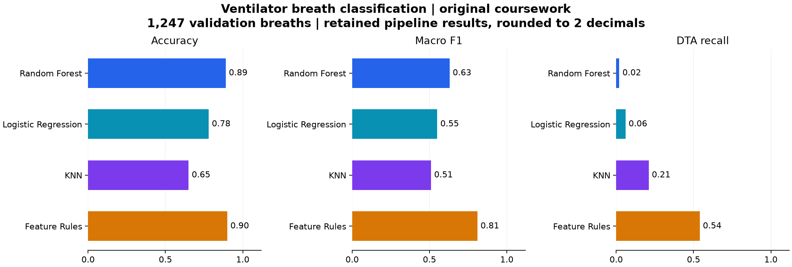
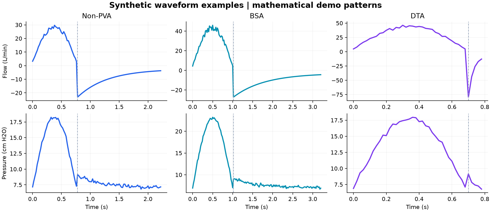

# Ventilator Breath Classification

**From flow and pressure signals to interpretable breathing features and per-class evaluation.**

I built a medical-data classification project in a course to identify patient–ventilator asynchrony: breaths where the patient's effort and the ventilator's delivery are out of sync. I extracted breathing features, compared three classifiers, implemented supplied domain rules, and studied the results by class.

The main finding: **89% accuracy hid approximately 2% recall for double-trigger cases.** Looking at each class changed which baseline appeared useful.



*Retained January 2026 coursework outputs, rounded to two decimals. Validation: 1,247 breaths. These reported pipelines include the original notebook's previous-row prediction adjustments.*

## What I implemented

- Eight additional features from ventilator flow and pressure, including inhaled volume, expiration time, respiratory rate, and volume ratios.
- Random Forest, L1 Logistic Regression, and KNN comparisons using 16 numeric features.
- A feature-rule classifier based on definitions supplied in the course.
- Ten Random Forest seeds and five-fold stratified cross-validation.

This repository turns that work into a standalone Python package. It adds a deterministic waveform demo, explicit label joins, patient-separated evaluation, saved run records, figures, and automated tests. The data and notebook structure for the original project were supplied by the course; the public implementation here is newly organized code.

## The problem

| Label | Meaning | Question behind the features |
|---|---|---|
| 0 · Non-PVA | No labelled breath-stacking or double-trigger event | Does the breath follow the reference pattern? |
| 1 · BSA | Breath-stacking asynchrony | How does exhaled volume compare with inhaled volume? |
| 2 · DTA | Double-trigger asynchrony | Is expiration unusually short with a low volume ratio? |

A breath is represented by flow in L/min and airway pressure in cm H2O. Features give the classifiers a compact description with physical meaning. Patient and breath identifiers link data to labels; they are excluded from model inputs.

## Run the demo

Python 3.11 or 3.12:

```bash
git clone https://github.com/ChenSiyun1234/ventilator-breath-classification.git
cd ventilator-breath-classification
python -m venv .venv
```

Activate the environment:

```powershell
# Windows PowerShell
.\.venv\Scripts\Activate.ps1
```

```bash
# macOS / Linux
source .venv/bin/activate
```

Install and run:

```bash
python -m pip install -e ".[dev]"
python -m ventilator demo --out artifacts/demo --seed 42
python -m pytest
```

The command generates 24 synthetic patients and 960 breaths, extracts all 16 features, holds out entire patients, trains the baselines, and writes:

| Output | Contents |
|---|---|
| `metrics.json` | Cleaning counts, split details, package versions, per-class results, confusion matrices, training-only grouped CV |
| `predictions.csv` | Breath identifiers, reference labels, and model predictions |
| `waveforms.png` | Three example flow/pressure traces |
| `model_comparison.png` | Accuracy, macro F1, and DTA recall |
| `confusion_matrices.png` | Counts for each true/predicted class |
| `waveforms.csv`, `features.csv`, `labels.csv` | Generated inputs for exercising the CSV workflow |

**The demo uses synthetic mathematical patterns.** Its scores describe software behavior on generated examples. The original medical-data findings are recorded separately in [coursework results](results/coursework_metrics.json).

The [saved demo run](results/demo/README.md) includes its figures, complete metrics, and dependency versions. For the recorded Python 3.12 environment, install `requirements-py312.lock.txt` before the editable package.



## Original medical-data results

| Reported pipeline | Accuracy | Macro F1 | DTA recall |
|---|---:|---:|---:|
| Random Forest | 0.89 | 0.63 | 0.02 |
| L1 Logistic Regression | 0.78 | 0.55 | 0.06 |
| KNN, k = 5 | 0.65 | 0.51 | 0.21 |
| Supplied feature rules | 0.90 | 0.81 | 0.54 |

The validation set contained 842 Non-PVA, 301 BSA, and 104 DTA breaths. Macro F1 gives equal weight to the three classes; DTA recall answers how many labelled DTA breaths were detected. The rule baseline performed better on both measures in this saved comparison.

Separate experiments recorded mean DTA recall of **0.0365** across ten Random Forest seeds, and mean macro F1 of **0.7079** for five-fold stratified Logistic Regression. See [methodology](docs/methodology.md) for the split, prediction adjustments, and experiment details.

## Use your own data

Convert permissioned, segmented waveform data into the canonical format in [the data guide](docs/data.md):

```bash
python -m ventilator extract --waveforms data/waveforms.csv --output data/features.csv
python -m ventilator evaluate --features data/features.csv --labels data/labels.csv --out artifacts/evaluation
```

The public evaluator reserves patients with `GroupShuffleSplit`. Scaling is fitted inside each model pipeline using training rows only. Cross-validation runs on the training patients, with a fresh pipeline fit in each fold. Labels join on `(patient, breath_id)` rather than row position. This is a new evaluation path; the historical table above comes from the original coursework protocol.

## Explore the project

```text
src/ventilator/
  features.py      Waveform validation and 16-feature extraction
  data.py          Keyed label joins, filtering, and audit counts
  models.py        Three classifiers, feature rules, patient split
  evaluation.py    Shared validation set, grouped CV, JSON reports
  synthetic.py     Reproducible generated waveform examples
  plotting.py      Waveform, metric, and confusion-matrix figures
  cli.py           demo / extract / evaluate commands
tests/             Units, joins, class metrics, splitting, full pipeline
results/           Historical aggregate results and saved demo run
docs/              Data contract, methodology, provenance, interview guide
```

For a spoken walkthrough, start with [the interview guide](docs/interview-guide.md). Original work: January 2026. Public package: October 2026. This is an educational medical-signal analysis project. See [provenance and data scope](docs/provenance.md) and the [MIT license](LICENSE) for the public code.
