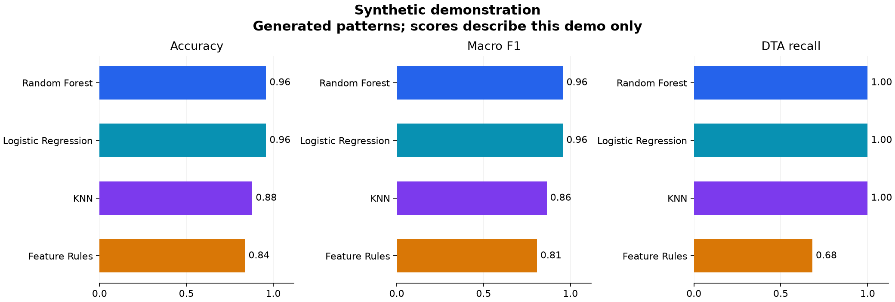
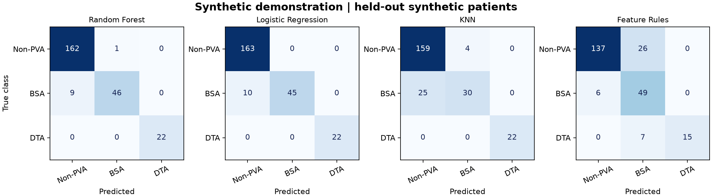

# Saved synthetic demo run

Run on October 16, 2026:

```bash
python -m ventilator demo --out artifacts/demo --seed 42
```

Generated 24 synthetic patients × 40 breaths = 960 breaths. Held out six patient groups: 720 training breaths and 240 validation breaths, with **zero patient overlap**. The validation classes were 163 Non-PVA, 55 BSA, and 22 DTA. All features and labels passed the input checks.

| Model | Accuracy | Macro F1 | DTA recall |
|---|---:|---:|---:|
| Random Forest | 0.958 | 0.957 | 1.000 |
| L1 Logistic Regression | 0.958 | 0.957 | 1.000 |
| KNN | 0.879 | 0.864 | 1.000 |
| Feature Rules | 0.838 | 0.807 | 0.682 |

These are generated-pattern results. Class-dependent durations and volume ratios make the task deliberately learnable. The historical medical-data comparison is in [coursework_metrics.json](../coursework_metrics.json).





[metrics.json](metrics.json) contains the full per-class reports, confusion matrices, training-only patient-grouped cross-validation, random seed, and dependency versions. [requirements-py312.lock.txt](../../requirements-py312.lock.txt) records the tested Python 3.12 dependencies.

Local validation: 20 tests passed. The `extract` → CSV → `evaluate` workflow reproduced the in-memory demo's split, model scores, and confusion matrices exactly.
